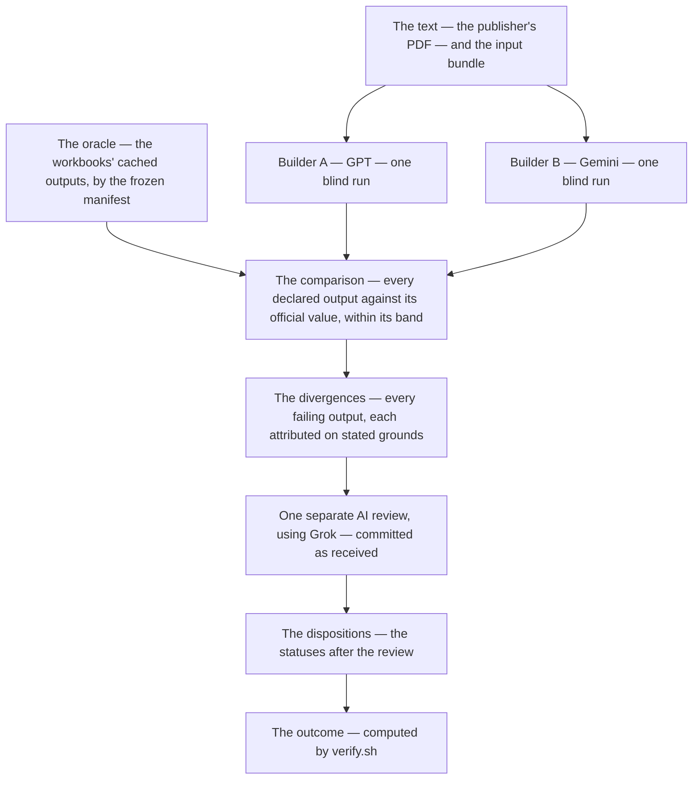

# Replicability test 01 — EIOPA's RFR Technical Documentation of 2026

One test, complete in this folder: its question and its falsifier frozen before any build, the builds as returned, the pass-or-fail table, the divergences and their attribution, one review as received — a separate AI review using Grok, the «independent review» of the preregistration —, the dispositions, and one command, `verify.sh`. The command checks artifact integrity, regenerates the comparison table and computes the outcome from the recorded attribution statuses. It does not assess the grounds of those attributions. Paths below are this folder's; commands run from the repository's root.

## The question

From the published documentation alone, can two blind builders of different model families reproduce the text's own worked examples — and where they cannot, which passages caused it, on what grounds?

The text is EIOPA's RFR Technical Documentation (EIOPA-BoS-26/198), published on 26 May 2026 with three workbooks of worked examples. Six cases were declared before any build — A1, A2 and A3 on the first workbook, B1 and B2 on the second, C1 on the third —, 535 official outputs in all. The publisher's four files are pointed to, never copied: `source/README.md` gives each by its address, its snapshot and its sha256.

This is a replicability test: two independent implementations of a public text, each set against the publisher's own worked examples. It makes no regulatory-accountability claim of any kind, and it attributes no error to the text's owner.

## The falsifier

The claim under test, for each declared case: the published documentation suffices to reproduce the case's official outputs. A case is *reproduced* when both builders pass it — every one of its outputs within the band set for it before any build. It is *not reproduced — the text* when a divergence is attributed to a passage, the passage named: the claim is then falsified for that case. It is *not reproduced — other causes* when every divergence is attributed to the oracle, the channel, a builder or propagation, and *undecided* when a divergence is left unresolved and none is attributed to the text. The outcome is *all reproduced* when every case is reproduced, and *not reproduced* otherwise, each case's category and passages named. The bands, the attribution rule, the falsifier and the stop rule stand in `preregistration/PREREGISTRATION.md` (§5, §6 and §8), frozen with the first commit.

## The result

`verify.sh` computes the outcome from the table and from the statuses of the divergences. Its lines:

```text
A1: reproduced
A2: reproduced
A3: reproduced
B1: reproduced
B2: reproduced
C1: not reproduced — the text: G.5.5 with G.5.3; G.1.2
outcome: not reproduced
```

Both builders reproduce every official output of A1, A2, A3, B1 and B2 within its band. C1 fails for both: four of build-a1's nine outputs and one of build-b1's lie outside their bands — five divergences, every failing output, none chosen, all on C1's corporate reference portfolio. After the review and the dispositions each of the five is attributed to the text. build-b1's `rcs` — the passage G.1.2: the text names no rounding of an index's duration, and the workbook's own sheet rounds it to one decimal. build-a1's `s_corp`, `rc_corp`, `s` and `rc` — the passage G.5.5 with G.5.3: the text constructs the yield of a type its Table 13 lacks from the euro yield of that type, and does not say what the rows the input supplies for credit quality steps 4 and 5 are. The divergence log, frozen with the third commit, attributed those four to the builder and named the other reading for the review; the review found the four to be the text's by the log's own rule, and the dispositions accept it. A divergence attributed to a passage is a reading the passage allows, set beside the publisher's own example.

Each of these sentences rests on a numbered claim of `NOTE.md`, set there beside its evidence — claims 1, 13, 20 and 23 to 25.

## What it does not show

- No regulatory-accountability claim of any kind; nothing about the publisher's production curves, whose inputs are licensed market data; nothing about the shocks this text does not carry.
- Two runs, two builders, six cases: one run per builder is one sample — no rate of success, no ranking of model families (claim 30).
- A «reproduced» is weaker evidence that the text suffices than a «not reproduced» attributed to a passage is evidence that it does not: the text was published after both builders' stated training cutoffs, and the method it documents was public before both (claim 29).
- The method is not compared with human reviewers or with established providers.
- What is verified is the archive: each builder's code and outputs as returned. Repeating the agent generation may produce different code. This verification uses the archived outputs and does not rerun generation (claim 9).
- The comparison tool carries a second party's check; its tests carry none (`comparison/SECOND-PARTY-CHECK.md`; claims 16 and 17). `verify.sh` carries its author's own controls and no second party's check.
- The limits in full — the review's reach among them — are in `NOTE.md`.

## «Independent»

The word is used here in three senses, each of which a reader can check.

- **The builders.** Two model families — builder A, OpenAI's `gpt-6-astra`; builder B, Google's `gemini-4-argon` —, each run once, as one agent, and blind: it received the brief, the text's PDF and the input bundle; it saw no official output, no workbook, no repository and nothing of the other builder's work; its network reached its vendor's interface alone, with no web search and no fetch (`preregistration/PREREGISTRATION.md`, §4; each run's egress log under `builds/`; claim 7).
- **The oracle.** The publisher's own worked examples — the workbooks' cached outputs, read by the manifest frozen before any build — and never the author's computation (claim 3).
- **The review.** A separate AI review using Grok: one session of an AI model of a family other than the builders', outside the builds, given the whole table, the divergence log with every attribution and its grounds, the text, the brief and the claims beside their evidence; committed as received, under its token, before any disposition was written (`preregistration/PREREGISTRATION.md`, §9; `review/REVIEW.md`). It is not a review by a person or an organisation; its product, its version, its settings and the limits of its session are in `NOTE.md`, under «The review's reach».

None of the three means independent of the author, who designed the test, wrote its tools, its attributions and its dispositions, prepared what the review read and started its session. Between the author and the result stand the order — each stage frozen under a timestamp token before the next —, the second party's check of the comparison tool, the review, and `verify.sh`, which a reader runs.

## The protocol



## The record — five commits, each under a timestamp token

Each commit froze one stage before the next could touch it, and carries an RFC 3161 timestamp token over the list of its own files.

| commit | what it froze | its id | its token's time (UTC) |
|---|---|---|---|
| first | the text's pointers, the manifest and the preregistration with the brief and the envelope — before any build | `61cccd36145e454e643fb1f01a64bcd13840fa50` | 2026-11-01 08:15:16 |
| second | the builds as returned and their egress logs — before any comparison | `6656882d117bf65ca4df320f8bfd57f5c45b458f` | 2026-11-01 22:00:21 |
| third | the comparison tool with its tests and its second party's check, the pass-or-fail table and the divergence log | `58190ce4fc0796603ffcc81728980c539d41a500` | 2026-11-13 21:24:03 |
| fourth | the review as received — before any disposition | `43f32954c0b4af75570845561eaae1976c9c1376` | 2026-11-14 16:21:59 |
| fifth | the dispositions, the model spend, this file and the note, `verify.sh`, the folder's manifest and the licence | the commit that carries this file | in `timestamps/v.tsr` |

The ids and the times, read from the repository itself:

```sh
git log --reverse --format='%H %s'
for n in i ii iii iv v; do openssl ts -reply -in 01-eiopa-rfr-2026/timestamps/$n.tsr -text | grep 'Time stamp'; done
```

A commit's own date is whatever its machine's clock said; the token's time is the timestamp authority's. A token dates the files' bytes as committed, not the acts before them. Both builds ran after the first token and before the second (claim 5). `verify.sh` checks every token against its list, its files and its commit's tree.

## The folder

- `README.md` — this file. `NOTE.md` — the note: its first page the test in short, then the claims, numbered, each beside its evidence, and the limits.
- `source/README.md` — the publisher's four files: each by its address, its snapshot and its sha256.
- `manifest/` — the input-to-oracle manifest: every declared range of inputs and of official outputs by its digest, and the tool that reads them.
- `preregistration/` — the preregistration, frozen before any build, with the builders' brief, the envelope they ran in and the tools that write and check the input bundle and set the bands.
- `builds/` — each builder's code and outputs as returned, with the egress log of its run.
- `comparison/` — the comparison tool, its tests, and the record of the tool's second party's check.
- `isolated/` — each build's own code for A2 and A3, run on the official A1 curve.
- `table/` — the pass-or-fail table: every output (`table/table.tsv`), every case (`table/cases.tsv`), every divergence (`table/divergences.tsv`).
- `divergences.md`, `divergences/` — the divergence log as frozen with the third commit, its reference computation and that computation's run.
- `review/REVIEW.md` — the review, as received: a separate AI review using Grok.
- `dispositions/` — the dispositions of the review, row by row, and the statuses of the divergences after it (`dispositions/statuses.tsv`).
- `effort.md` — the model spend, run by run.
- `timestamps/` — each commit's file list and its token, and the timestamp authority's root certificate.
- `MANIFEST.sha256` — the sha256 of every file of this folder.
- `verify.sh` — the command of «To verify»: what it checks, and what it does not, is said there.

## To verify

```sh
sh 01-eiopa-rfr-2026/verify.sh "$HOME/eiopa-rfr-files"
```

The folder named last is where the command keeps the publisher's four files, which this repository does not hold: it fetches each one there, and a later run finds them there. `$HOME/eiopa-rfr-files` is an example; any folder will do, and the command makes it if it is not there.

The command checks artifact integrity, regenerates the comparison table and computes the outcome from the recorded attribution statuses. It does not assess the grounds of those attributions.

It needs Python 3.9 or later and `openssl` — the standard library alone —, and `git` where the folder is a checkout. It works in five steps and says what each checked. It fetches the publisher's four files — each from its address, else from its snapshot —, holds each to its sha256 and keeps it in the folder given, where a later run finds it. It makes every digest of the manifest again from the workbooks' own XML. It checks each commit's file list, its files, its commit's tree and its timestamp token, and `MANIFEST.sha256`. It makes the pass-or-fail table again with the comparison tool, held to its sha256, byte for byte. And it computes the outcome. With `--offline` it fetches nothing and reads the four files from the folder given. It exits 0 only when every step holds; a step that fails or is not run is named. It does not run the builders again, and it cannot judge an attribution's grounds: the reader does.

`verify.sh` makes the manifest's digests with a reader of its own, not with `manifest/manifest.py`, which needs the `openpyxl` library. For the frozen tool's own run, with that library: `python3 -I 01-eiopa-rfr-2026/manifest/manifest.py "$HOME/eiopa-rfr-files"` — the folder `verify.sh` kept the files in, which holds the three workbooks under the names that tool reads.
